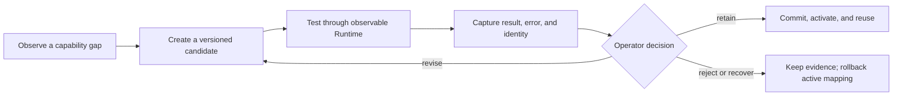
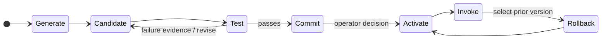
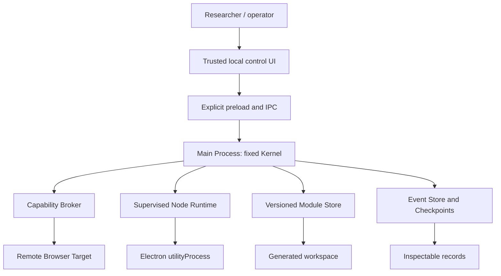

# BlankSeed Browser

> An experimental Electron + Chromium runtime for researching how AI agents can create, test, retain, and revise reusable capabilities from low-level primitives.

[繁體中文](readme.zh-tw.md) · [Architecture](docs/ARCHITECTURE.md) · [Operator guide](USER_GUIDE.md) · [Project status](PROJECT_STATUS.md)


> **Research prototype; source build only.** BlankSeed Browser is a Windows-first local research environment. It is not a consumer browser, Chrome extension, production automation product, or a sandbox that safely contains arbitrary generated code.

## Research question

Most agent systems begin with a predefined vocabulary of business actions. BlankSeed studies another path: an agent identifies a capability gap, creates an inspectable candidate, tests it in a governed runtime, and retains a version for reuse only after an explicit approval.

The goal is not uncontrolled self-modification. It is evidence-backed, reversible capability evolution.

## Get started

Requirements: Windows 10/11 is recommended, with Node.js 22 or later and npm.

```powershell
cd starter
npm install
npm run check
npm test
npm start
```

These commands launch the local Electron application from source. The project does not claim to provide a signed installer, store distribution, or an automatic-update channel.

For the interactive local tutorial, run `npm run tutorial:open` from `starter/`. The tutorial is loopback-only: it does not visit real websites, submit credentials, contact a model provider, or apply a module.

## Experiment loop



Every generated capability is an inspectable artifact with source identity, execution evidence, validation results, and a bounded recovery path. A passing test is necessary evidence, but it does not prove semantic correctness or host safety, and it does not authorize activation.

## Capability lifecycle



`Commit` creates an immutable module version. `Activate` is a separate, explicit decision. Rollback changes the active-module mapping to a selected committed version; it does not reverse external effects that an invocation may already have caused.

## Runtime architecture



The fixed Kernel provides raw infrastructure families, not a task whitelist. Generated semantic behaviour belongs in versioned modules and evolution artifacts, rather than hidden branches in the Main Process.

### Non-negotiable boundaries

- Every arbitrary remote page runs with `nodeIntegration: false`, `contextIsolation: true`, and `sandbox: true`.
- Page, CDP, process, module, and checkpoint work pass through the Capability Broker or shared event pipeline so that they remain observable.
- Generated Node.js source runs in a supervised Electron `utilityProcess`, outside the Main Process. This is an observability and recovery boundary, **not** an OS security sandbox.
- Candidate creation, testing, immutable commit, activation, and rollback are distinct transitions. Normal activation still requires explicit operator confirmation.

## Current evidence and limits

The [2026-07-20 project snapshot](PROJECT_STATUS.md) records Windows Electron runtime evidence through WP-11, including deterministic-fixture evidence for capability evolution and reuse. It also records the present limits:

- WP-12 real-model evaluation is `PRE-FLIGHT HOLD / NOT RUN`; the project makes no claim about real-model quality or prompt-injection resistance.
- Phase 1 is implemented, but completion evidence for two regression cases is still pending.
- Generated Node execution can be supervised and terminated; that is not host containment.
- Automatic acceptance of source changes, parallel evolution, dependency-change handling, and concurrent candidate handling are not yet verified.

## Documentation

| Need | Document |
| --- | --- |
| Setup, local data, and operating flow | [Operator guide](USER_GUIDE.md) |
| System boundaries and data flow | [Architecture](docs/ARCHITECTURE.md) |
| Module state, evidence, activation, and rollback | [Capability lifecycle](docs/AGENT_CAPABILITY_LIFECYCLE.md) |
| Threat model and recovery limits | [Security model](docs/SECURITY_MODEL.md) |
| Implementation and verification boundaries | [Project status](PROJECT_STATUS.md) · [Validation report](VALIDATION_REPORT.md) |
| Real local-model evaluation protocol | [WP-12 protocol](11_WP12_REAL_MODEL_EVALUATION_PROTOCOL.md) |
| Complete technical handoff | [README handoff (Traditional Chinese)](README_HANDOFF.md) |

## What BlankSeed Browser is not

- A replacement for existing browser automation tools.
- A fully autonomous AGI system or unrestricted self-modifying agent.
- A Chrome extension, Chromium fork, consumer browser, or Chrome Web Store product.
- A sandbox that can safely execute arbitrary Node.js code.

## License

Released under the [MIT License](LICENSE).
