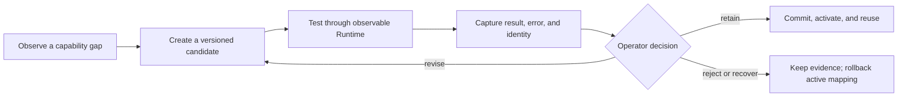
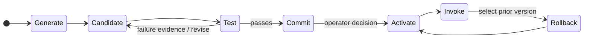
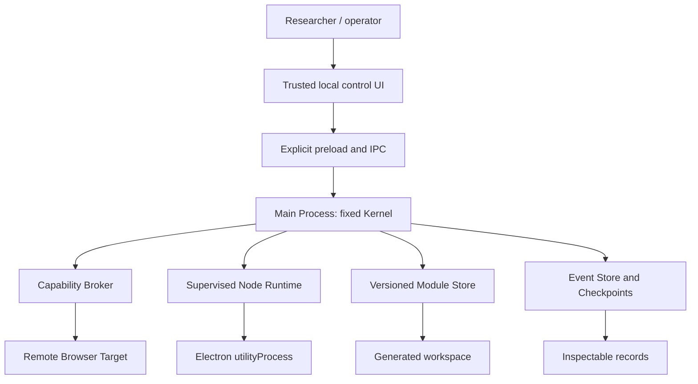

# BlankSeed Browser

> 一個以 Electron + Chromium 建立的實驗性 Runtime，用來研究 AI Agent 如何從底層原語建立、測試、保存與修訂可重複使用的能力。

[English](readme.md) · [架構](docs/ARCHITECTURE.zh-tw.md) · [操作說明](USER_GUIDE.zh-tw.md) · [專案狀態](PROJECT_STATUS.zh-tw.md)


> **研究原型，僅提供 source build。** BlankSeed Browser 是 Windows 優先的本機實驗環境；它不是一般消費者瀏覽器、Chrome Extension、正式自動化產品，也不是能安全隔離任意生成程式碼的 sandbox。

## 研究問題

多數 Agent 系統由預先定義的商業 action vocabulary（動作詞彙）開始。BlankSeed 研究的是另一條路：讓 Agent 發現能力缺口、建立可檢視的 Candidate、在受治理的 Runtime 中測試，並只在明確核准後保存可供日後重用的版本。

目標**不是**不受控制的自我修改，而是有證據、可復原的能力演化。

## 開始使用

需求：建議使用 Windows 10/11、Node.js 22 以上版本與 npm。

```powershell
cd starter
npm install
npm run check
npm test
npm start
```

上述指令會從原始碼啟動本機 Electron 應用程式；專案未聲稱提供簽章安裝程式、商店發行或自動更新通道。

若要啟動互動式本機教學，請在 `starter/` 執行 `npm run tutorial:open`。教學只提供 loopback-only 模擬：不會造訪真實網站、提交憑證、聯絡模型供應商或 Apply Module。

## 實驗迴圈



每項生成能力都是可檢視的 artifact，具有 source identity、執行證據、驗證結果與有限的復原路徑。測試成功是必要證據，但不代表語意正確、主機安全，亦不授權啟用。

## Capability lifecycle



`Commit` 會建立不可變的 Module 版本；`Activate` 是另一個明確決定。Rollback 只會將 active Module mapping 切回已選定的 committed version，不會倒轉 invocation 可能已造成的外部效果。

## Runtime 架構



固定 Kernel 提供的是 raw infrastructure families（底層基礎設施類別），而不是任務白名單。生成的語意行為應存在於版本化 Module 與演化 artifact，而非藏在 Main Process 分支中。

### 不可妥協的邊界

- 任意遠端頁面一律以 `nodeIntegration: false`、`contextIsolation: true`、`sandbox: true` 執行。
- Page、CDP、process、Module 與 checkpoint 工作會經過 Capability Broker 或共用 event pipeline，保持可觀測。
- 生成的 Node.js source 會在受監督的 Electron `utilityProcess` 執行，位於 Main Process 之外。這是可觀測與復原邊界，**不是** OS security sandbox。
- Candidate 建立、測試、不可變 commit、activate 與 rollback 是彼此分離的 transition；一般啟用流程仍需 operator 明確確認。

## 現有證據與限制

[2026-07-20 專案快照](PROJECT_STATUS.zh-tw.md) 記錄了截至 WP-11 的 Windows Electron Runtime 證據，包括以 deterministic fixture 驗證的能力演化與重用；同時也明確記錄目前限制：

- WP-12 真實模型評估為 `PRE-FLIGHT HOLD / NOT RUN`；未對真實模型品質或 prompt-injection resistance 提出聲明。
- Phase 1 已有實作，但兩項 regression case 的完成證據仍待補齊。
- 生成的 Node 執行可受監督並終止，但不代表具備 host containment。
- 自動接受 source 變更、平行演化、dependency change 處理與 concurrent candidate 處理尚未獲得證實。

## 文件導覽

| 需求 | 文件 |
| --- | --- |
| 安裝、本機資料與操作流程 | [操作說明](USER_GUIDE.zh-tw.md) |
| 系統邊界與資料流 | [架構](docs/ARCHITECTURE.zh-tw.md) |
| Module state、證據、activate 與 rollback | [Capability lifecycle](docs/AGENT_CAPABILITY_LIFECYCLE.zh-tw.md) |
| 威脅模型與復原限制 | [Security model](docs/SECURITY_MODEL.zh-tw.md) |
| 目前實作與驗證邊界 | [專案狀態](PROJECT_STATUS.zh-tw.md) · [驗證報告](VALIDATION_REPORT.zh-tw.md) |
| 真實本機模型評估協定 | [WP-12 協定](11_WP12_REAL_MODEL_EVALUATION_PROTOCOL.zh-tw.md) |
| 完整技術交接 | [README handoff（繁體中文）](README_HANDOFF.md) |

## BlankSeed Browser 不是什麼

- 既有瀏覽器自動化工具的替代品。
- 完全自主的 AGI 系統，或不受限制的自我修改 Agent。
- Chrome Extension、Chromium fork、一般消費者瀏覽器，或 Chrome Web Store 產品。
- 可安全執行任意 Node.js 程式碼的 sandbox。

## 授權

`UNKNOWN`：目前未檢視到此 repository 的 license 檔案。請勿假設可重用或再散布的權利。
